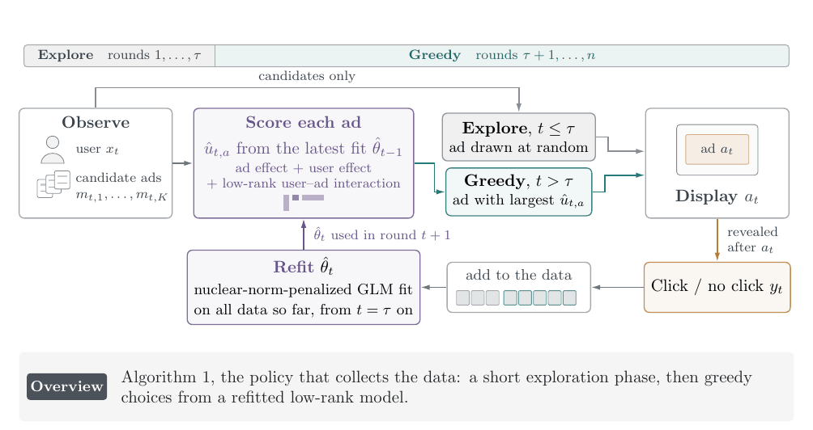
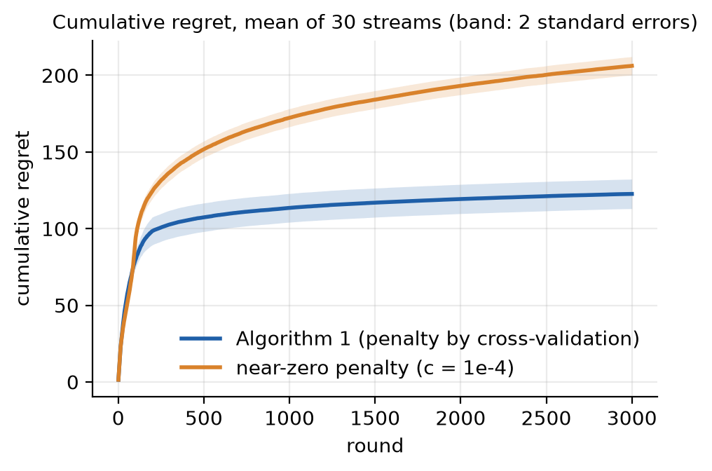
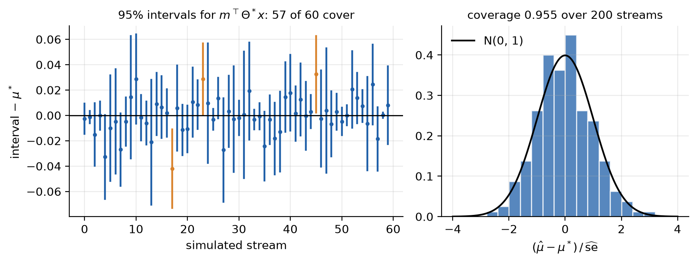
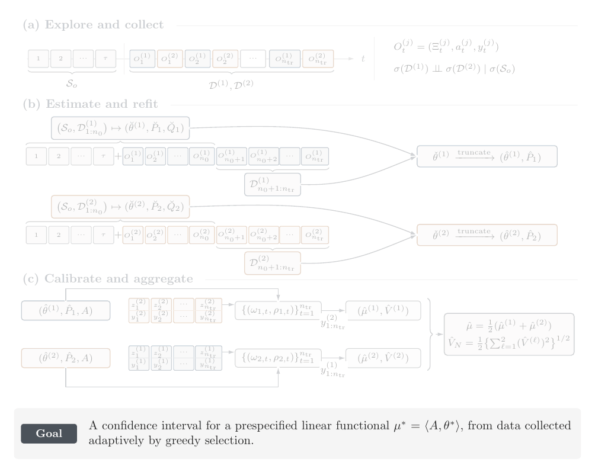

<h1 align="center">lowrankbandit</h1>

<p align="center">
  <b>Greedy contextual bandits with a low-rank interaction,<br>
  and asymptotically valid confidence intervals from greedily collected data.</b>
</p>

<p align="center">
  <a href="https://github.com/kxu-stat/lowrankbandit/actions/workflows/python.yml"></a>
  <a href="https://github.com/kxu-stat/lowrankbandit/actions/workflows/R-CMD-check.yml"></a>
  <a href="https://kxu-stat.github.io/lowrankbandit/"></a>
  
  
  <a href="LICENSE"></a>
</p>

<p align="center">
  
</p>

An ad platform shows one of $K$ candidate ads to each arriving user. Whether the user clicks depends on how the ad's
features interact with the user's, through a $d_1 \times d_2$ matrix of interaction effects that is typically of low
rank. **lowrankbandit** learns this matrix while it chooses the ads, and afterward answers questions about it, such
as *how strongly does this kind of user respond to this kind of ad*, with confidence intervals that are
asymptotically valid although every choice was made greedily from the data.

It is the code accompanying *Regret Minimization and Statistical Inference for Low-Rank Contextual Generalized Linear
Bandits, with Applications to Advertising and Product Design* by Ke Xu, Yuefeng Han and Zifeng Zhao.

- **Regret minimization (Algorithm 1).** A short uniform exploration, then greedy choices from a
  nuclear-norm-penalized GLM refitted every round, with its penalty tuned by cross-validation inside the run. The
  aim is low regret: little expected reward lost against the best arm of each round.
- **Inference after greedy choices (Algorithm 2).** Data collected by two greedy tracks after a shared exploration,
  a refit on the tangent space of low-rank matrices and a predictable calibration give asymptotically normal
  estimates and confidence intervals for linear functionals $\langle A, \theta^* \rangle$ of the parameter, such
  as one interaction effect or the effect of a given ad on a given user.
- **Python and R.** The same functions, arguments and defaults; given the same rounds, the two packages return the
  same numbers, which the tests check.
- **Few dependencies.** Six source files per language, one function per step of the algorithms; numpy and scipy in
  Python, base R only.

## Installation

```bash
pip install "git+https://github.com/kxu-stat/lowrankbandit.git#subdirectory=python"
```

```r
remotes::install_github("kxu-stat/lowrankbandit", subdir = "R")
```

## Quick start

Simulate 3,000 rounds, collect the data with the two-track policy, and estimate the effect of a new ad on a new user
(about five seconds):

```python
import numpy as np
import lowrankbandit as lrb

# each round shows one of 20 candidate ads (10 features each) to one user (10 features)
Theta = lrb.low_rank_truth(10, 10, rank=2, rng=1)                  # the rank-2 interaction
stream = lrb.simulate_stream(3000, 10, 10, K=20, Theta=Theta, noise_sd=0.5, seed=2)

policy = lrb.TwoTrackPolicy(10, 10, horizon=3000, seed=3)
for t in range(policy.horizon):
    a = policy.choose(stream.arms[t], stream.contexts[t])          # the ad to show
    policy.observe(stream.reward(t, a))                            # its reward

# the target: the effect m' Theta x of a new ad m on a new user x
rng = np.random.default_rng(4)
m, x = rng.standard_normal(10), rng.standard_normal(10)
A = lrb.interaction_loading(np.outer(m, x), p0=0)
res = lrb.two_track_inference(policy.data(), A, rank=2)
print(f"estimate {res['estimate']:.3f}, 95% interval [{res['lower']:.3f}, {res['upper']:.3f}]")
print(f"truth {m @ Theta @ x:.3f}")
```

```text
estimate 1.204, 95% interval [0.813, 1.595]
truth 0.999
```

<details>
<summary>The same in R</summary>

```r
library(lowrankbandit)
set.seed(2)
Theta <- low_rank_truth(10, 10, rank = 2)
s <- simulate_stream(3000, 10, 10, K = 20, Theta = Theta, noise_sd = 0.5)

policy <- two_track_policy(10, 10, horizon = 3000)
for (t in 1:policy$horizon) {
  a <- policy$choose(s$arms[t, , ], s$contexts[t, ])                # the ad to show (1, ..., K)
  policy$observe(s$reward(t, a))                                    # its reward
}

m <- rnorm(10); x <- rnorm(10)                                      # a new ad m and a new user x
A <- interaction_loading(m %o% x, p0 = 0)
res <- two_track_inference(policy$data(), A, rank = 2)
cat(sprintf("estimate %.3f, 95%% interval [%.3f, %.3f]\ntruth %.3f\n",
            res$estimate, res$lower, res$upper, drop(m %*% Theta %*% x)))
```

```text
estimate 1.542, 95% interval [1.302, 1.782]
truth 1.397
```

R draws its own random numbers, so its stream and numbers differ from Python's.

</details>

In an application, the loop is your system: pass the candidates' features and the context to `choose`, show the
chosen arm, and pass its reward to `observe`. [Getting started](https://kxu-stat.github.io/lowrankbandit/getting-started/)
continues the example with Algorithm 1 alone and several targets at once, and shows how to switch to binary rewards
or add main effects.

## What it does, on simulated data

<p align="center">
  
</p>

On 30 simulated streams, the same greedy policy with a near-zero penalty ($c = 10^{-4}$) pays about 1.7 times the
regret of Algorithm 1, whose penalty is tuned by cross-validation inside the run.

<p align="center">
  
</p>

Over 200 simulated streams, the 95% intervals of Algorithm 2 covered the truth 191 times, and the standardized
estimates follow the standard normal distribution, although the arms were chosen greedily. Both figures are made by
[`python/examples/make_figures.py`](python/examples/make_figures.py).

## How it works

**Algorithm 1** (animation above): explore uniformly for $\tau \asymp (d_1 + d_2)\log n$ rounds; then, in every
round, fit the nuclear-norm-penalized maximum likelihood estimate on all rounds so far and show the arm with the
largest fitted reward.

**Algorithm 2** (animation below) collects the data with two greedy tracks that take the rounds in turn after a
shared exploration, each learning from the exploration and its own rounds only. Each track's estimate is refitted
on the tangent space of rank-$r_0$ matrices and corrected with the residuals of the *other* track, whose weights are
fixed before each reward is seen; the two folds are averaged. Because the tracks do not depend on each other, the
correction is a martingale, and the estimate is asymptotically normal.

<p align="center">
  
</p>

[How it works](https://kxu-stat.github.io/lowrankbandit/how-it-works/) gives every step with its formula, and
[Settings](https://kxu-stat.github.io/lowrankbandit/settings/) every default.

## Documentation

**<https://kxu-stat.github.io/lowrankbandit/>**: getting started, the algorithms step by step, the settings, and the
function reference for [Python](https://kxu-stat.github.io/lowrankbandit/reference/python/) and
[R](https://kxu-stat.github.io/lowrankbandit/R/reference/).

## Repository

| Folder | Contents |
|---|---|
| [`python/`](python) | the Python package: source, tests, examples |
| [`R/`](R) | the R package: the same six source files, tests, examples |
| [`reproduction/`](reproduction) | the code of the paper's numerical study (simulations and the MIND news data); separate from the package |
| [`docs/`](docs) | the documentation website and the LaTeX sources of the animations |

## Reproducing the paper

[`reproduction/`](reproduction) holds the code that produced the paper's tables and figures: the regret
comparisons with OFUL (Abbasi-Yadkori, Pál and Szepesvári, 2011) and ESTR (Jun, Willett, Wright and Nowak, 2019),
the inference simulations and the MIND news-recommendation study, with a self-test and instructions for every
run.

## Citation

```bibtex
@unpublished{xu2026lowrankbandit,
  title  = {Regret Minimization and Statistical Inference for Low-Rank Contextual Generalized Linear Bandits,
            with Applications to Advertising and Product Design},
  author = {Xu, Ke and Han, Yuefeng and Zhao, Zifeng},
  year   = {2026},
  note   = {Manuscript}
}
```

## License

MIT, except the two functions from the code of Jun, Willett, Wright and Nowak (2019) in
[`reproduction/regret/lrbandit/`](reproduction/regret/lrbandit), which keep their Apache-2.0 license.
