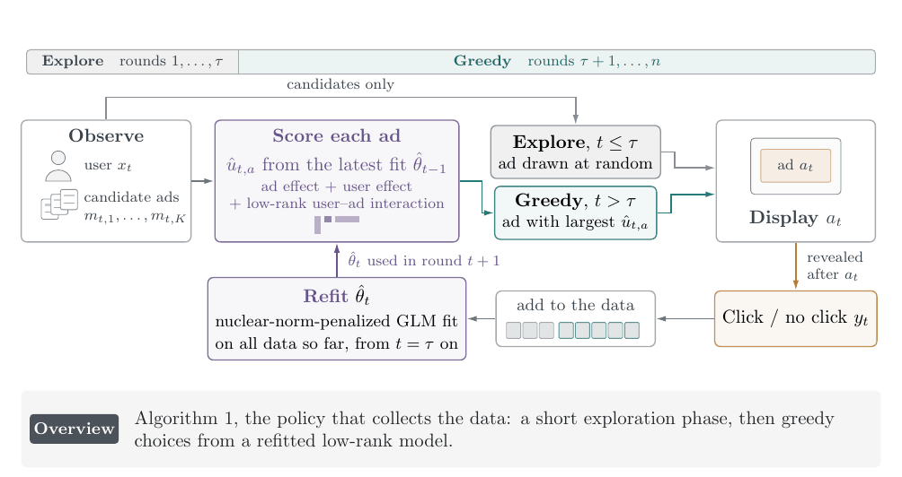
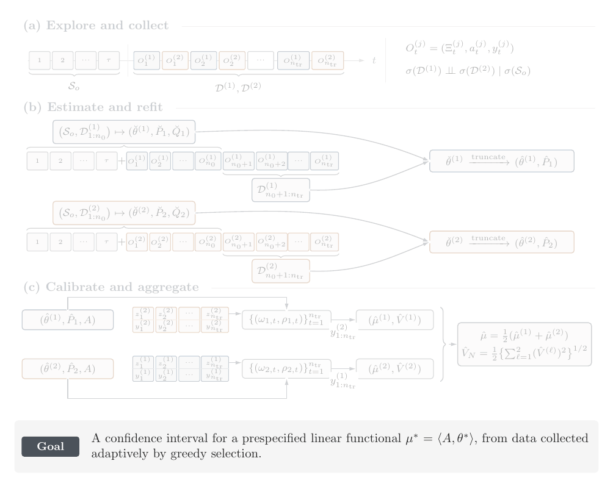

# How it works

## The model

In round \(t\) the policy sees \(K\) candidate arms with features \(m_{t,a} \in \mathbb{R}^{d_1}\) and a context
\(x_t \in \mathbb{R}^{d_2}\), shows one arm \(a_t\), and observes its reward \(y_t\). The reward of arm \(a\) follows
a generalized linear model with linear predictor

\[
u_{t,a} \;=\; c_{t,a}^\top \gamma \;+\; m_{t,a}^\top \theta_m \;+\; x_t^\top \theta_x \;+\; m_{t,a}^\top \Theta\, x_t ,
\]

where the interaction \(\Theta \in \mathbb{R}^{d_1 \times d_2}\) has low rank \(r_0\), and the main effects
\((\gamma, \theta_m, \theta_x)\), of further covariates \(c_{t,a}\) of the arm and of the two feature vectors, are
optional. Stacking the coefficients as \(\theta = (\gamma, \theta_m, \theta_x, \operatorname{vec}\Theta)\), whose
first \(p_0\) entries are the main effects, and the features as the design row
\(z_{t,a} = (c_{t,a}, m_{t,a}, x_t, \operatorname{vec}(m_{t,a} x_t^\top))\) gives
\(u_{t,a} = \langle z_{t,a}, \theta\rangle\).

The expected reward is \(\psi'(u_{t,a})\), with \(\psi(u) = u^2/2\) for Gaussian rewards and
\(\psi(u) = N \log(1 + e^u)\) for binomial rewards out of \(N\) trials (`trials`). The regret over \(n\) rounds is
the expected reward lost against the best arm of each round, \(\sum_{t \le n} \{\max_a \psi'(u_{t,a}) -
\psi'(u_{t,a_t})\}\).

## Algorithm 1: greedy choices from a low-rank fit

1. **Explore.** For the first \(\tau = \lceil c_\tau (d_1 + d_2 + p_0) \log(n d_1 d_2) \rceil\) rounds, choose an
    arm uniformly at random.

2. **Fit.** Estimate \(\theta\) by nuclear-norm-penalized maximum likelihood on the \(s\) rounds so far,

    \[
    \hat\theta_s = \arg\min_\theta \; \frac1s \sum_{i \le s} \big\{\psi(\langle z_i, \theta\rangle) - y_i
    \langle z_i, \theta\rangle\big\} + \lambda_s \|\Theta\|_* ,
    \]

    with penalty level

    \[
    \lambda_s = c\, \hat\sigma \sqrt{\frac{(d_1 + d_2)\log(n d_1 d_2)}{s}} ,
    \]

    where \(z_i\) and \(y_i\) are the design row and reward of the arm shown in round \(i\). The nuclear norm
    \(\|\Theta\|_*\), the sum of the singular values, pulls the estimate toward low rank. The scale \(\hat\sigma\) is
    computed once from the exploration rounds, and the constant \(c\) is chosen by 10-fold cross-validation on the
    run's own data whenever the sample size doubles ([Settings](settings.md) gives both).

3. **Choose greedily.** Show the arm with the largest fitted predictor \(\langle z_{t,a}, \hat\theta\rangle\),
    observe its reward, refit, and repeat.

There is no exploration after the first \(\tau\) rounds: the variation of the contexts and of the candidate sets
keeps the greedy choices informative.

## Algorithm 2: inference after greedy choices

The target is a linear functional \(\mu^* = \langle A, \theta^* \rangle\) of the true parameter, given by its
loading \(A\): for example \(A = \operatorname{vec}(e_i e_j^\top)\) for the entry \(\Theta^*_{ij}\), or
\(A = \operatorname{vec}(m x^\top)\) for the effect \(m^\top \Theta^* x\) of an ad \(m\) on a user \(x\)
(`interaction_loading` pads \(A\) with zeros for the main effects). Greedy choices depend on the past, so standard
errors that treat the rounds as independent are not valid, and the penalized estimate is biased toward low rank.
Algorithm 2 addresses both.

**Step 1 (collection).** The first \(\tau\) rounds, \(\mathcal{S}_o\), are a shared uniform exploration. After it,
two greedy tracks take the rounds in turn, \(n_{\rm tr}\) rounds each. Each track runs Algorithm 1 on
\(\mathcal{S}_o\) and its own rounds only, so its choices never depend on the other track. The analysis uses the
tracks twice: fold \(j \in \{1, 2\}\) estimates with track \(j\) and calibrates with the other track, \(j'\).

**Step 2 (fold fit).** Fit on \(\mathcal{S}_o\) and the first \(n_0\) rounds of track \(j\) (the preliminary fit),
and truncate the interaction to rank \(r_0\). Near the truncated fit, the matrices of rank \(r_0\) form, to first
order, a linear space of dimension \(p_T = p_0 + r_0(d_1 + d_2 - r_0)\): the tangent space. Refit within this space
on the remaining \(n_{\rm ref} = n_{\rm tr} - n_0\) rounds of track \(j\), by a predictable recursion (the weight of
round \(t\) is fixed before its reward is used) with ridge
\(\lambda_{\rm ref} = n_{\rm ref}\hat\kappa / (2 C_{\rm ref} \log n_{\rm ref})\), and truncate again. This gives
\(\hat\theta^{(j)}\). The information constant \(\hat\kappa\) is the average eigenvalue of the exploration rounds'
curvature-weighted Gram matrix on the tangent space.

**Step 3 (calibration on the other track).** Over the \(n_{\rm tr}\) rounds of track \(j'\), a second predictable
recursion with ridge \(\lambda_{\rm cal} = n_{\rm tr}\hat\kappa / (2 C_{\rm cal} \log n_{\rm tr})\) gives weights
\(\omega_t\), each fixed before \(y_t\) is seen, and

\[
\mu^{(j)} = \langle A, \hat\theta^{(j)} \rangle + \sum_{t \in j'} \{ y_t - \psi'(\langle z_t, \hat\theta^{(j)}
\rangle)\}\, \omega_t ,
\]

\[
\big(V^{(j)}\big)^2 = \sum_{t \in j'} \{ y_t - \psi'(\langle z_t, \hat\theta^{(j)} \rangle)\}^2 \omega_t^2 .
\]

**Step 4 (aggregation).** \(\hat\mu = (\mu^{(1)} + \mu^{(2)})/2\) and \(\hat V_N = \tfrac12 \sqrt{(V^{(1)})^2 +
(V^{(2)})^2}\). The interval at level \(1 - \delta\) (`level`) is \(\hat\mu \pm \Phi^{-1}(1 - \delta/2)\, \hat V_N\),
with \(\Phi\) the standard normal distribution function.

**Why two tracks.** Given the exploration, the rounds of track \(j'\) do not depend on track \(j\). The correction of
Step 3 is therefore a martingale over track \(j'\), whose normalized sum is asymptotically normal, while the
estimate \(\hat\theta^{(j)}\) it corrects comes from the other track. Averaging the two folds uses every round once
for estimation and once for calibration.

The theory, the conditions and the proofs are in the paper.
