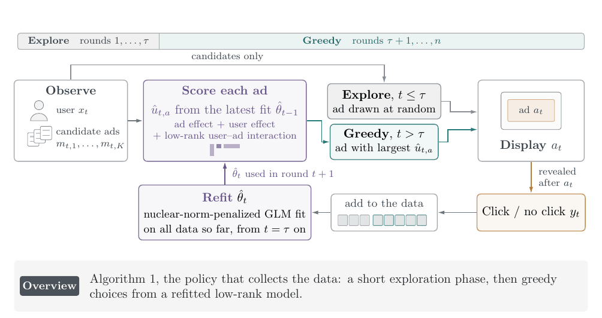
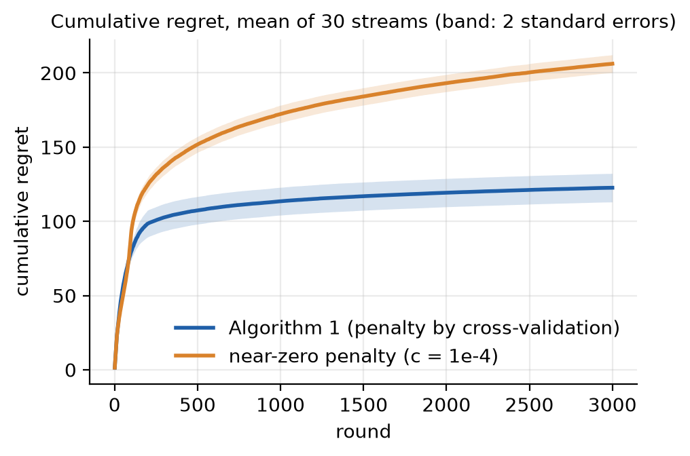
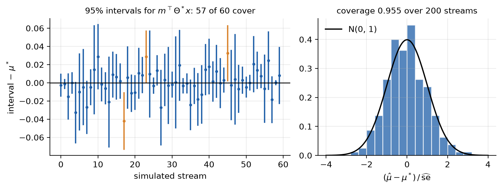

# lowrankbandit

**Greedy contextual bandits with a low-rank interaction, and asymptotically valid confidence intervals from greedily
collected data.**

An ad platform shows one of \(K\) candidate ads to each arriving user. Whether the user clicks depends on how the
ad's features interact with the user's: a \(d_1 \times d_2\) matrix of interaction effects, typically of low rank.
`lowrankbandit` learns this matrix while it chooses the ads, and afterward answers questions about it with
confidence intervals that are asymptotically valid although every choice was made greedily from the data.

It is the code accompanying *Regret Minimization and Statistical Inference for Low-Rank Contextual Generalized Linear
Bandits, with Applications to Advertising and Product Design* by Ke Xu, Yuefeng Han and Zifeng Zhao.



<div class="grid cards" markdown>

-   :material-trending-down:{ .lg .middle } **Regret minimization**

    ---

    Algorithm 1: a short uniform exploration, then greedy choices from a nuclear-norm-penalized GLM refitted every
    round, its penalty tuned by cross-validation inside the run.

-   :material-chart-bell-curve:{ .lg .middle } **Inference after greedy choices**

    ---

    Algorithm 2: data from two greedy tracks after a shared exploration, a refit on the tangent space and a
    predictable calibration give asymptotically normal estimates of linear functionals
    \(\langle A, \theta^*\rangle\).

-   :material-language-python:{ .lg .middle } **Python and R**

    ---

    The same functions, arguments and defaults in both languages; given the same rounds, the same numbers
    (checked by the tests).

-   :material-file-code-outline:{ .lg .middle } **Few dependencies**

    ---

    Six source files per language, one function per step of the algorithms. numpy and scipy in Python; base R
    only.

</div>

## The interface

In outline, with `arms`, `contexts`, `reward_of` and the loading `A` standing for your own data
([Getting started](getting-started.md) has a complete example that runs as it is):

=== "Python"

    ```python
    import lowrankbandit as lrb

    policy = lrb.TwoTrackPolicy(d1, d2, horizon=n)
    for t in range(policy.horizon):
        a = policy.choose(arms[t], contexts[t])  # K x d1 arms, d2 context
        policy.observe(reward_of(a))             # show arm a, record reward

    res = lrb.two_track_inference(policy.data(), A, rank=2)
    print(res["estimate"], res["lower"], res["upper"])
    ```

=== "R"

    ```r
    library(lowrankbandit)

    policy <- two_track_policy(d1, d2, horizon = n)
    for (t in 1:policy$horizon) {
      a <- policy$choose(arms[t, , ], contexts[t, ])  # K x d1 arms, d2 context
      policy$observe(reward_of(a))                    # show arm a, record reward
    }
    res <- two_track_inference(policy$data(), A, rank = 2)
    print(c(res$estimate, res$lower, res$upper))
    ```

## What it does, on simulated data

The low-rank penalty is what makes greedy choices learn fast: on the same streams, the same greedy policy with a
near-zero penalty (\(c = 10^{-4}\)) pays about 1.7 times the regret.

{ width="560" }

Over 200 simulated streams, the 95% intervals of Algorithm 2 covered the truth 191 times, and the standardized
estimates follow the standard normal distribution, although the arms were chosen greedily.



Both figures come from `python/examples/make_figures.py`; the paper's simulations and the MIND news-recommendation
study are in [Reproducing the paper](reproducing.md).

## Where next

- [Getting started](getting-started.md): installation and a complete example in Python and R.
- [How it works](how-it-works.md): the model and the two algorithms, step by step.
- [Settings](settings.md): every default, and how to change it.
- Reference: [Python](reference/python.md) and [R](https://kxu-stat.github.io/lowrankbandit/R/reference/).
